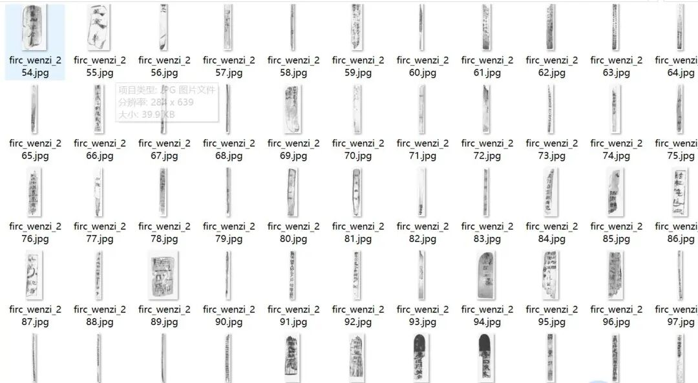
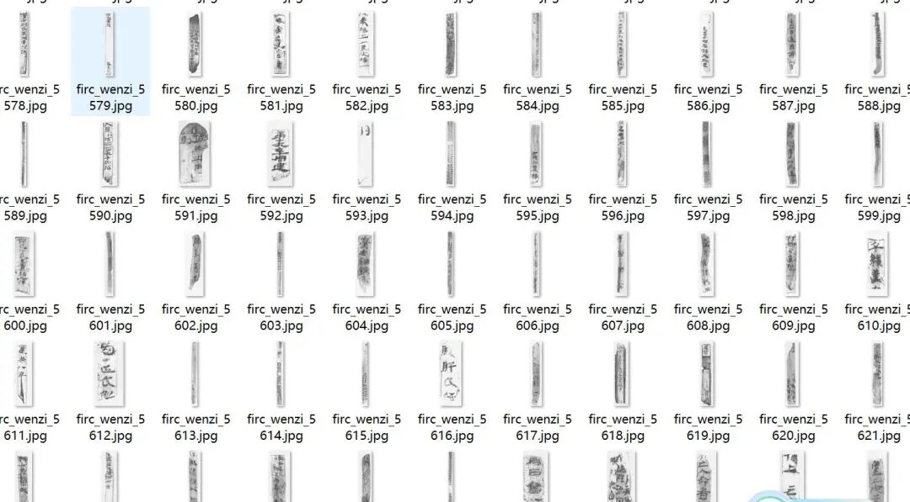
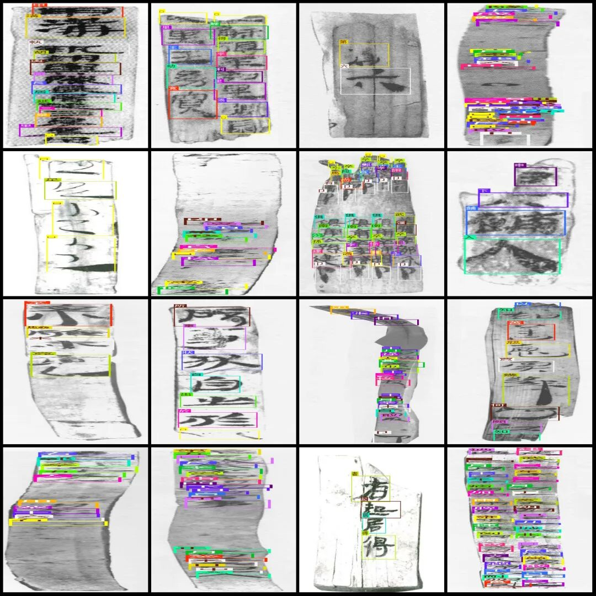

# Briefs Text Detection Dataset VOC+YOLO format with 7416 images and 2242 categories

Dataset format: Pascal VOC format + YOLO format (txt file without split path, only contains jpg images and corresponding VOC format xml files and yolo format txt files)

Number of images (number of jpg files): 7416

Number of annotations (number of xml files): 7416

Number of annotations (number of txt files): 7416

Labeling category count: 2242

Label category names(NoteyoloThe format category order does not correspond to this, but instead...labelsFolderclasses.txtPrecision):["□","ム","㒇","㒼","㛐","㞷","㡒","㢕","㢮","㯼","㷅","㹆","䅃","䅣","䅭","䊮","䊼","䊽","䌛","䌳","䏢","䖟","䜌","䝼","䦝","䰡","One","Ding","Seven","T","Wan","Measuring","Three","Up","Down","No","Die","Ugly","And","World","Chu","Cinnamon","East","Output:","Two","And","|","Chinese","Marshmallow","Dan", "Zhu", "Pi", "Nai", "Jiu", "Zhi", "He", "Fa", "Cheng", "Yi", "Qi", "Yi", "Shu", "Rui", "Gan", "Luan", "Le", "Yi", "Yu", "Shi", "Er", "Yu", "Yun", "Qi", "Wu", "Jing", "Qiang", "Luan", "Le", "Yi", "Xian", "Fu", "Jing", "Jing", "Ting", "Qin", "Qin", "Ren", "Shi", "Ren", "Shi", "Qiu", "Yin", "Jing", "Jing", "Ji", "Hai", "Yi", "Xiang", "Ji", "Ji", "Fei", "Fu", "Wu", "Fu", "Fu", "Fu", "Fu", "Fu", "Fu", "Fu", "Fu""Output:","Bit","Zuo","Yu","He","Tu","Deleted","Output: Perform","You","Pei","Ba","Good","Merge","Outline","Output:","Come","Translation: Wait","Output:","Provided","In accordance with","Unicode","Hou","Infringement","Output:","Plain","Promote","Output:","Folk","Downward","Bao","Yu","Swordsman","Letter","All","Storage","Double","Qian","Waiting","Sit","Borrow","Promote","Qian","Lun","Yan","False","Wang","Oblique","Accompany","Health","B","Occasionally","Steal","Fu","Jie","Output:","Strain","Angry","Translate","Debt","Scar","Output:","Mu","Shuo","Wu","Jiao","Bu","Yi","Luo","Ru","Tong","Chang","Chu","Yuan","Xian","Zou","Ru","Nei","Quan","Er","Bai","Du","Rui","Chun","Gang","Ke","Meng","Gong","Ji","Lan","Gong","Bing","Kuang","Ke","Die","Fen","Xing","Fan","Fan","Gu","Zhu","Chou","Mao","Gan","Jian","Dian","Yi","Li","Zhi","Qi","Ge","Dian","Yun","He","Ji","Nan","Chu","Chu","Shou","Han","Nei","Quan","Er","Ba","Du","Rui","Chu","Chu","Hou","Mao","Gan","Gou","Zhu","Chu","Chu","Yu","Bing","Kuang","Ke","Die","Fen","Xing","Fan","Fan","Gu","Zhu","Chou","Mao","Gan","Jian","Dian","Yi","Li","Zhi","Qi","Ge","Dian","Yun","He","Ji","Nan","Chu","Chu","Shou","Han","Nei","Quan","Er","Ba","Du","Rui","Chu","Chu","Hou","Mao","Gan","Gou","Zhu","Chu","Chu","Yu","Bing","Kuang","Ke","Die","Fen","Xing","Fan","Fan","Gu","Zhu","Chou","Mao","Gan","Jian","Dian","Yi","Li","Zhi","Qi","Ge","Dian","Yun","He","Ji","Nan","Chu","Chu","Shou","Han","Nei","Quan","Er","Ba","Du","Rui","Chu","Chu"Initial","Delete","Decide","No","Lei","Delete","No","To","Production","Note: No translation provided.","Sting","Carve","Then","Scrap","Previous","Pu","Auxiliary","Slash","Create","Plagiarism","No translation provided.","Liu","Sword","Force","Work","Add","Assist","Robbery","Effect","Hui","Strong","Decree","Brave","Mian","Command","Le","Move","Output:","Win","Lao","Trend","Industrious","1.2","Honors","Promote","No","Hungarian","Output:","Chemical","North","Artisan","Kang","Pig","Output:","Hide","Output:","Ten","Thousand","Thirty","Fall","No output","Half","Shuang", "Bai", "Zhu", "Shandan", "Nan", "Bo", "Bu", "Zhan", "Wei", "Ye", "Yin", "Wei", "Zhi", "Qie", "Juan", "Qing", "Guo", "Ji", "Qie", "Qu", "Chao", "Qing", "Gong", "Hou", "Chou", "Ru", "You", "Yu", "Ru", "Chu", "Qian", "Cong", "Gu", "Ju", "Ju", "Jia", "Gui", "Tong", "Ming", "Hou", "Li", "Su", "Tu", "Yue", "Xun", "Wu", "Wu""I","Lu","Not sure","Zhou","Hush","Life","No output.","And","Ju","Qi","Salty","Sadness","Product","Ya","Employee","Tang","Only","Trade","Question","Start","Shu","Good","Joy","Death","Output:","Scarcity","Subsequent","Jia","Tastes","Device","Strict","Capsule","Output only the English term:","Sentence","Four","Back","Due to","Stagnation","Output:","Glue","Output:","Output: None","Output:","Park","Output:","In","Gu","Earth","Output:","Equal","Sit","Valley","Kun","Pu","Output:","City","Equal","Pu","Output:","Cavity","Tang","Output:","Steel","Dié","Outpost","Report","Block","Block","Paint","Se","Cave","Warehouse","House","Increase","Increase","Ink","Dense","Wall","Bad","S","Ren","Strong","Strong","One","Longevity","Summer","Output:","Out","Multi","Night","Large","Tian","Too","Fu","Central","Loss","Head","Yi","Yān","Odd","Nie","Feng","Output:","Seize","Female","Neutral","Evil","Good","As such.","Female","Wife","Nephew","Sister","Begin","Guan","Family name","Delegate","Yao","Beautiful","Slander","Wa","Ping","Marry","Slave","Female", "Angry", "Marriage", "Sister", "Infant", "Child", "Confucius", "Characteristic", "Existence", "Piety", "Meng", "Junior", "Lonely", "Grandson", "Who?", "Learning", "Young", "Other", "Home", "House", "Guardian", "Safety", "Song", "Complete", "Broad", "Clan", "Official", "Cosmos", "Determination", "Wan", "Appropriate", "Guest", "Xuan", "Study", "Palace", "Palace", "Government", "Kingdom", "Ruler", "Harm", "Family", "Respect", "Generosity", "Cold", "Lodging", "Investigation", "Loneliness", "Entrustment", "Yin", "Secret", "Knight", "Treasure", "Thickness", "Temple""Fold","Shoot","Output:","No output","Yu","Respect","Search","Yes","Small","Less","Output:","Yu","Just","Yin","Measuring tape","Ke","Settle","Tu","House","Screen","Scrap","Show","Output:","Threshing","Repeatedly","Foot","Output:","Tun","Mountain","Cen","Riverbank","Chong","Cui","Cliff","Yu","Wa","Chuan","State","Shan","Output:","Left","Craftsmanship","Giant","Poor","Self","Output:","Output:","Empty","Alley","Xun","Output:","Market","Fabric","Hi","Broom","Silk","Die","Output:","-","Teacher","Output:","Xi","Band", "Common", "Cape", "Flag", "Coin", "Dry", "Level", "Year", "Jointly", "Fortune", "Young", "Almost", "Order", "Gunpowder", "Facility", "Land", "Hall", "Extension", "Town Square", "Common People", "Healthy", "Weak", "Strong", "Powerful", "Punishment", "Slow", "Path", "Success", "Waiting", "Law", "Aftermath", "Slowly", "Walking", "Achievement""From", "Protect", "Silent", "Recover", "Follow", "Micro", "Prove", "Desire", "Benevolence", "Precaution", "Aversion", "Endurance", "Intent", "Forget", "Loyalty", "Quick", "Anger", "Thought", "Irritation", "Fury", "Contemplation", "Worry", "Resentment", "Haste", "Grief", "Shock", "Forgiveness", "Disease", "Hate", "Encouragement", "Regret", "Distress", "Trembling", "Patience", "Joy", "Kindness", "Cautious", "Confidence", "Joy", "Anxiety", "Sympathy", "Respect", "Calm", "Wisdom", "Joy", "Dread", "Guardianship", "Discretion", "Joy", "Hope", "Love", "Mercy", "Indulgence", "Evil", "Incitement", "Regret", "Peril", "Self-restraint", "Apprehension", "Remorse", "Fear", "Forgiveness", "Disease", "Envy", "Joy", "Hesitation", "Worry", "Grief", "Aversion", "Endurance", "Intent", "Forget", "Loyalty", "Quick", "Anger", "Thought", "Irritation", "Fury", "Contemplation", "Worry", "Resentment"Wai","Hysteria","Stupid","Unanswerable","Wu","Xu","1.","Ying","Complete","I","Abandon","Or","Qi","Spear","Battle","Play","Dai","House","House","Strict","House","Output:","Flat","Hu","Hand","Support","Accept","Output: Output","Invest","Fold","Unveil","Cuddle","No translation provided.","Deal","Translate","Pu","Strict","By","Holding","Vibrate","Holding","Catch","Donate","Fight","Catch","Roll","Grant","Hand","Ye","Push","Shan","Yuan","Insert","Yī","Yang","Change","Assist","Pound","Pang","Mo","Withdraw","Proficient","Choose", "Attack", "Capture", "Twist", "Snap", "Support", "Collect", "Revise", "Attack", "Release", "Policy", "Cause", "Effect", "Angry", "Fail", "Teach", "Weak", "Open", "Dare", "Spread", "Deep", "Enemies", "Count", "Shrink", "Fold", "Strike", "New", "Cut", "Break", "Square", "On", "Side", "Camp", "Already", "Day", "Dawn", "Purpose", "Early", "Meaning", "Early", "Tenth", "Time", "Kin", "Bright", "Midnight", "Change", "Yesterday", "Spring", "Dusk", "Last Night", "Whisper", "Now", "Clear", "Yesterday", "Sleepy", "Brightness", "This Time""Jin", "Yan", "Day", "Hui", "Morning", "Pu", "Scene", "Hot", "Dusk", "Blast", "Calendar", "Dawn", "Extent", "Say", "Curve", "Change", "Heaven", "Book", "Cao", "Man", "Zeng", "Most", "Meeting", "Moon", "Friends", "Suit", "Qu", "Xu", "Observe", "Bark", "Stand", "Li", "Apricot", "Wood", "Staff", "Bamboo Stick", "Duo", "Boundary", "Come", "Bottle", "East", "Plough", "Nut", "Wooden Block", "Pillow", "Forest", "Seed", "Rice Husk""Zhi", "Gou", "Lun", "Ling", "Bing", "Bo", "Mo", "Yi", "Ruan", "Ng", "Chu", "Chai", "Xin", "Shuan", "Suan", "Li", "Gua", "Jiao", "Zhugu", "Chu", "Chu", "Shuan", "Li", "Guo", "Gang", "Cheng", "Qiang", "Tao", "An", "Sang", "Huang", "Peng", "Ji", "Shi", "Gan", "Ge", "Gang", "Cheng", "Zhang", "Chang", "Ming", "Pang", "Kan", "Huai", "Kuai", "Fan""Fan", "Lo", "Model", "Horizontal", "Plain", "Tree", "Bamboo", "Bridge", "Tube", "Horizontal", "Jin", "Script", "Document", "Pole", "Inspection", "Check", "Climbing", "Second", "Joy", "Cough", "Desire", "Insolence", "Praise", "Stop", "Correct", "This", "Step", "Warrior", "Year", "Return", "Death", "Devastation", "Partial", "Rise", "Era", "Slay", "Shell", "Palace", "Beating", "No", "Mother", "Apex", "Poison", "Comparison", "Whisker", "Family", "Qi", "Water", "Enduring", "Spread", "Juice", "Seek", "Perspiration", "Extinguishment", "You", "Yangtze"."Poo","Chi","Hui","Wen","Jue","Shen","Mu","Mo","Mo","Tuo","Sha","Pei","Ji","Ju","Gou","Kang","Xie","Quan","Fa","Nian","Zhu","Liao","Dong","Jin","Gu","Kuai","Luo","Dong","Jin","Gu","Ge","Li","Sui","Hong","Liang","Xiao","Fan","Xia","Hong","Niao","Hai","Ne","Jing","Jing","Quan","Jian","Chun","Yuan","Yuan","Yu","Du","Wen","Wei","You","Hu","Liang","Liang","Nao","Huai","Huai","Paint","Filter","Leakage","Cao","Han","Stain","Pan","Lu","Tan","Jian","Ze","Muddy","Ji","Output:","Emit","Fire","Gray","Disaster","Jing","Cook","Xin","Carbon","For","Output: wu","Steam","Smoke","Irritating","Yan","Burn","None","Jiao","No translation provided.","Sulfur","Huang","Smoke","Irritated","Boiling","Hot","Xi","Burn","Burn","Yan","Output:","Struggle","Love","Love","To","Jie","Father","Bed","Zang","Version","Document","Cow","Vagina","Mo","Male","Stable","Herding","Object","Special","Tie","Plow", "Banner", "Cattle", "Sacrifice", "Dog", "Offense", "Formation", "Insanity", "Fox", "Wolf", "Whispering", "Violent", "Guess", "Weak", "Pig", "Prison", "Aoist", "Unique", "Reward", "Wild", "Mysterious", "Rate", "Jade", "King", "Pearl", "Present", "Logic", "Clarinet", "Glazed", "Tile", "Clay", "Vase", "Bucket", "Clay Pot", "Gourd", "Sweet", "Very, Very Sweet", "Birth", "Production", "Useful", "Furrow", "Ning", "Field", "Path", "Heavy Armor", "Shield", "Keep", "Herd", "Land", "Complete", "Briefly", "Fair", "Extremely", "Born", "Given", "Boundary", "Stay", "Livestock", "Meadow", "Endeavors", "Paintings", "Different", "Right", "Frontier"."Chou","Dié","Yi","Ji","Bing","Tong","Shu","Chou","Lu","Geng","Gui","Deng","Fan","Zhi","Miao","Zhen","Hua","Dui","Shi","Lu","Miǎo","Du","Zhēng","Mǎn","Xiān","Miǎo","Zhēn","Yǎn","Mù","Shè","Shi","Qi","Zhǔ","Hù","Zhù","Qi","Jìn","Jìn","Shen","Shi","Liú","Lu","Mù","Shi","Shi","Qi","Liú","Mao","Yǐ","Zhī","Du","Du","Zhěng","Jiān","Lü","Mù","Shi","Li", "Lu","Mu","Lu","Yi","Fu","Ai","Zen","Output: rite","Pray","Yu","Output:","Bird","Horn","Private","Autumn","K","Rent","Qin","Seed","Rank","Shu","Stalk","Move","Strain","Corn","Cheng","Sorghum","Slight","Tax","Pseudocereal","Young","Bing","Seed","Empty","Name","Ji","Rice","Output: grain","Check","Sorghum","Grain","Mu","Square","Young","Output:","Ying","Sweet rice","Rang","Chong","Empty","Dress","Blunt","Poor","Fill","Dou","Oven","Establish","And","Surprisingly","Zhang","End","Bamboo","Laugh","Punishment","Output:","Fu","1.","Gu","Waiting","Build","Answer","Straight","Count","Ki","Calculate","Sticks","Pipe","Ba","Arrow","Box","Output:","Build","Box","Duo","Output:","Book","Output:","Cage","M","Fine powder","Sorghum","Grain","Precision","Sorghum","Mie","Feces","Food","No output.","Strain","Output:","Yue","Yu","Sew","Output:","Output:","Unable to translate the text into English.","Pure","Level","Plain","So","Cotton","Tired","Fine","Fu","Sir","Kuo","Silent","End","Group","Ban","Absence","Clean","Shuang","Twist","Network","Tie","Giving", "Fragrance", "Silk", "Dark Red", "Suspending", "Weaving", "Strict", "Rope", "Veil", "Celestial", "Rope", "Band", "Tie", "Slow", "Weave", "Edge", "Knitting", "Thread", "Tang", "Spun", "Spun", "Spun", "Spun", "Spun", "Spun", "Spun", "Spun", "Spun", "Spun", "Spun", "Spun", "Spun", "Spun", "Spun", "Spun", "Spun", "Spun", "Spun", "Spun", "Spun", "Spun", "Spun", "Spun", "Spun", "Spun", "Spun", "Spun", "Spun", "Spun", "Spun", "Spun", "Spun", "Spun", "Spun", "Spun", "Spun", "Spun", "Spun", "Spun", "Spun", "Spun", "Spun", "Spun", "Spun", "Spun", "Spun", "Spun", "Spun", "Spun", "Spun", "Spun", "Spun", "Spun", "Spun", "Spun", "Spun", "Spun", "Spun", "Spun", "Spun", "Spun", "Spun", "Spun", "Spun,"Group","Group","Output: yi","Weak","Feather","Wang","Next","Silver","Xi","Xī","Zhai","Han","Skip","Yao","Old","Exam","Producer","Yi","And","Endurance","End","Ear","Yes","Geng","Chat","Output:","Saint","Poly","Observe","No translation provided.","Sound","Nei","Job","Listen","Output:","Examination","Meat","Rib","Xiao","Liver","Fat","Shoulder","Ken","Education","Pulmonary","Stomach","Back","O","Hu","Xu","Glue","Chest","Yes","Fat","Threaten","Vein","Tibia","Repair","Remove","Protein","Spleen","Rag","Kidney", "Swollen", "Inflammation", "Intestine", "Abdomen", "Rise", "Gel", "Membrane", "Knee", "Arm", "Blood", "Rubber", "Lantern", "Officer", "Crushed", "Rust", "Table", "Official", "Sleep", "Heavenly", "Approach", "Self-proclaimed", "Standard", "Arrive", "Cause", "Platform", "Moment", "Hammer", "Pounding", "Fall", "Grain", "Flower", "Garden", "Seedling", "Cruelty", "Impoverishment", "Weakness", "Herb", "If", "Bitter", "Elegy", "Furrow", "Zither", "Villager", "Dance", "Boat", "Good", "Colorful", "Mulberry", "Grass", "Stalk", "Thistle", "Radish".Jing, Cao, Di, Zhuang, Geng, Cui, Ting, Hua, Li, Qi, Mo, Mao, Hua, Ling, Qi, Cui, Bie, Meng, Piao, Cao, Jiao, Mo, Guan, Ye, Zhuo, Luo, Bao, Ye, Zhuo, Gai, Dong, Wei, Bai, Cang, Peng, Cai, Ci, Tang, Shao, Bo, Shuai, Kui, Meng, Mu, Pu, Cang, Gai, Peng, Cai, Ci, Shou, Xiao, Bo, Bi, Kun, Kui, Cheng, Shen, Lan, Zai, Duan, Shang, Xian, Fou, Yu, Hao, Shao, Shang, Bu, Shuai, Kui, Cao, Cang, Gai, Peng, Cai, Ci, Tu, Da, Bai, Cao, Shi, Jue, Piao, Cao, Jiao, Mo, Guan, Xin, Jie, Lan, Zang, Yao, Suo, Niu, Cao, Ming, Piao, Cao, Liu, Kui, Ming, Meng, Piao, Cao, Liu, Kui, Cao, Ci, Zhuo, Shao, Bo, Xia, Shen, Jian, Lan, Zai, Peng, Hua, Xiong, Chu, Wu, Yu, Yu, Luo, Yu, Yu, Luo, Yu"Scorpion","Shu","Fly","Merge","Claw","Pu","Mang","Blood","Zhong","Moving","Translate","Output:","Output:","Watch","Sprint","Clothing","Table","Decline","Yuan","Coat","Shoes","Abundant","Translated:","Install","Output:","Qiu","Gown","Supplement","Output:","Output:","Benefit","Wrap","Complex","Shoe","Sleeve","Brown","Positive","Scarf","Chu","Praise","Xiang","Mix","Dān","Loincloth","Sweep","West","To","Over","See","Output:","Dear","Awareness","Observe","Visual","Angle","Goblet","Solution","Output:","Output:","Output:","Message","End","Record", "Litigation", "Praise", "Design", "Permission", "Hurting", "Diagnosis", "Criticism", "Deception", "Order", "Dissent", "Consultation", "Appearance", "Test", "Questioning", "Detailed", "Execution", "Exaggeration", "Indulgence", "Words", "Sincerity", "Falsehood", "Mistake", "Recitation", "Statement", "Request", "Discussion", "Assertion", "Denial", "Confession", "Silent", "Apology", "Respectful", "Mumble", "Proof", "Knowledge", "Talk", "Alert", "Translation", "Discussion", "Condemnation", "Protection", "Reading", "Change", "Complaint", "Concession", "Blame", "Record", "Sincerity", "Grain", "Stream"."Soybean","Ding","Feng","Vertical","Feng","Pig","Silence","Hou","Yu","Pig","Breed","Sex","Marten","Be","Zhen","Negative","Finance","Gong","Poor","Output: goods","Sell","Profit","Conduct","Responsibility","Yue","Output:","High","Downgrade","Buy","Loan","Fee","Trade","He","Output:","Ja","Thief","Bin","Lei","Bless","Enjoy","Xian","Sell","Low","Fu","Output: quality","Transport","Deliver","Purchase","Empty","Retrieve","Gan","Finance","Fail","Poor","High","He","Ja","Delegation","Bless","Excess","Gan","Red","Shuài", "Zǒu", "Qǐ", "Chāo", "Yue", "Zhào", "Qù", "Cù", "Lù", "Xū", "Zhào", "Qù", "Jiǎn", "Fù", "Jù", "Zhī", "Shēn", "Gōng", "Che", "Zhé", "Cè", "Xiàn", "Cǐ", "Hé", "Zhì", "Bèi", "Zhí", "Zhú", "Zhě", "Ní", "Guān", "Píng", "Chuán", "Zhóu", "Zhòu", "Jìn", "Pò", "Shù", "Cì", "Bìng", "Biàn", "Biàn", "Cí", "Biàn", "Zhēn", "Rǔ", "Nóng", "Zhēn", "Yíng", "Jìn", "Níng", "Pì", "Jìn", "Jì", "Nǎi", "Cǐ""Chasing","Deliver","Invert","Output:","Silent","Observe","This","Translate","Create","Feng","Continue","Catch","Enter","Succeed","Occur","Transport","Pass","Echo","D","Tà","Fu","Exclude","Suitable","Mask","Delay","Comply","Move","Select","Output:","Liao","Emerge","Output:","Output:","Yi","Yong","Han","Output:","Xing","Han","Bing","Output:","Expresses","Zhi","Lang","Hao","County","Qie","Department","Guo","Output:","All","Xiang","Zou","Zhang","Deng","Zheng","Yi","Output:","Output: xi","Ou","Drink","Alcohol","Acidic", "Bitter", "Sour", "Festive", "Pure", "Ugly", "Medical", "Craftsmanship", "Harvest", "Community", "Heavy", "Wild", "Quantity", "Gold", "Kettle", "Glass", "Welding", "Hammer", "Forging", "Lock", "Balance", "Ball", "Silver", "Copper", "Money", "Tin", "Record", "Razor", "Cone", "Coin", "Jade", "Silverware", "Sword", "Shield", "Steel", "Casting", "Drum", "Clock", "Iron", "Foundry", "Pile", "Long", "Wheel", "Long", "Door", "Yan", "Closed", "Open", "Grandeur"."Yùn","Xián","Jiān","Mín","Gé","Liá","Yuè","Yān","Kuò","Luò","Qiè","Bì","Ngā","Fàng","A", "Duō","Wèi","Fáng","A","Tuó","Fù","Chén","Xián","Líng","Táo","Xiàn","Zhuàn","Guān","Er","Céng","Fáng","Yán","Qū","Xiān","Yīn","Cén","Líng","Táo","Shān","Yáng","Dì","Lóng","Dài","Suí","Shuǐ","Yún","Xiān","Léi","Huò","Shuāng","Zhà","Jī","Yǎ","Duō","Fù","Yōng","Yōng","Luò","Zhēng","Zhōu","Yīn","Cì","Ní","Yán","Líng","Táo","Xiàn","Xiē","Luò","Yán","Zhù","Pí","Jù","Yǎ","Jí","Gù","Yōng","Luò","Luò","Shuì","Xiān","Róng","Luò","Tuǒ","Yán","Líng","Qìng","Fēi","Mí","Liǎn","Gé"Jin, Gui, Ju, Ji, Di, Bèi, Wei, Han, Jie, Yīn, Qǐng, Xiang, Shun, Xi, Song, Dùn, Pǒ, Lǐng, Yǎn, Náng, Yuàn, Lèi, Liang, Fēng, Shí, Fèn, Xǐn, Pǒ, Běi, Mǐng, Cān, Yǐn, Can, Yǐn, Rao, Shǒu, Xiāng, Tóu, Náng, Yán, Yuàn, Lèi, Sì, Qí, Luò, Hú, Qí, Jiàn, Gu, Fēng, Ma, Féng, Chi, Qiú, Jià, Zhōu, Sì, Ji, Láo, Rao, Ráo, Yú, Yǒu, Guǎn, Gǔn, Cuì, Yún, Cuī, Yún, Bǐng, Jié, Pǐ, Pǐ, Jǐng, Yíng, Shun, Xi, Xiān, Suǒ, Dùn, Pǒ, Pǒ, Pǒ, Lǐng, Pǒ, Pǒ, Pǒ, Yǐng, Pǒ, Pǒ, Pǒ, Pǒ, Pǒ, Pǒ"Zhou", "Shao", "Yan", "Jing", "Yi", "Huan", "Li", "Gou", "Gao", "Kun", "Bao", "Xian", "Di", "Li", "Wei", "Yu", "Lu", "Bao", "Xian", "Diao", "Feng", "Ming", "Hong", "Hong", "Yan", "Lu", "Mu", "Mei", "Li", "Dian", "Dian", "Jia", "Chi", "Cai", "Huang", "Huang", "Shu", "Hei", "Dian", "Jie", "Long", "Pang", "Yan", "Feng", "Ming", "Jue", "Ru", "Qiang", "Ma", "Kuai", "Hua", "Xian", "Di", "Li", "Fei", "Wu", "Zhe", "Qi", "Jie", "Cai", "Cai", "Duan", "Bi", "Mai", "Kuai", "Feng", "Bing", "Zhi", "Pang", "Liang", "Gong", "Yue", "Qu", "Du", "Zhong"."𣖡","𣟖","𣪠","𤅊","𤉷","𤟹","𤹯","𥄲","𥝷","𥿉","𦞈","𦭡","𦱂","𧘟","𧛯","𨒑","𨚫","𨛭","𨼾","𫃟","𭎁","𭔉","𭚇"]

Number of boxes labeled in each category:

□ Frame count = 6203

Frame count = 13

Frame count = 1

Frame count = 1

Box count = 1

Frame count = 1

Frame count = 21

Frame count = 1

Number of frames = 2

Frame count = 2

Number of frames = 1

Number of frames = 2

Frame count = 2

Number of frames = 8

Frame count = 11

Frame count = 12

Number of frames = 2

Number of frames = 1

Number of frames = 3

Frame count = 1

Number of frames = 1

Number of frames = 40

Number of frames = 4

Number of frames = 1

Frame count = 1

Number of frames = 1

1 Frames = 1571

Ding Frame Count = 209

7 Frames = 503

Frame count = 1

10,000 frames = 1

Frame count = 59

3. Frame count = 1608

Upper frame count = 253

Number of frames = 256

No Frames = 686

Box count = 1

Chou Frames = 187

And the number of frames = 26

World frame count = 51

Circular number = 33

C. Number of frames = 175

East Frame Count = 1

Number of frames = 120

Two boxes = 1

And the number of frames = 58

Frame count = 8

Frame count = 325

Margins = 1

Dan Frames = 24

Main Frame Count = 77

Frame count = 95

N = 38

Long box count = 25

Frame count = 668

Frame count = 7

Frame count = 18

Number of frames = 120

Frame count = 219

Nine Frames = 454

Requested Frames = 1

Also, the number of boxes = 41

Number of books = 1

Number of frames = 1

Frame count = 3

Unordered box count = 1

Number of boxes = 1

Number of frames = 73

Number of frames = 337

2. Frame count = 1572

Frame count = 36

Cloud box count = 9

The number of frames = 2

5 Frames = 1141

Number of well frames = 70

Number of frames = 169

Number of Frames = 17

Number of frames = 50

Number of frames = 18

Hexadecimal number = 149

Also, the number of frames = 12

Frame count = 2

Jing Frames = 6

Number of frames = 137

Dear, the number of frames = 1

Number of frames = 1

Number of people = 591

Frame count = 4

Number of frames = 37

Number of rectangles = 2

Number of Frames = 2

Today's frame count = 208

Number of rectangles = 1

Still, the number of boxes = 1

He has 5 frames.

Frame count = 151

Number of proxy frames = 44

Let the box number = 494

Frames = 709

Number of frames = 1

Number of frames = 36

Number of items = 3

Number of frames = 43

Number of frames = 1

Ji Frames = 1

Frame count = 6

Number of frames = 109

Frame count = 31

Number of frames = 39

Box count = 20

But the number of boxes = 8

Number of boxes = 1

Number of bitboxes = 3

Zuo Frame Count = 60

Box count = 1

How many frames = 100

Number of boxes = 2

Frame count = 1

Frame count = 111

You box count = 1

Pellets = 2

Bai Frames = 2

Number of frames = 2

Merge count = 1

Box count = 1

Frames = 117

Frame count = 196

Number of frames = 10

Number of frames = 1

Supply box quantity = 1

According to the frame count = 3

Frame count = 1

Hou Frame Count = 137

Intrusion count = 65

Frame count = 1

Frame count = 35

Promotion box count = 1

Number of frames = 1

Common frame count = 1

Downward Frame Count = 1

Number of frames = 7

Yu Frames = 2

Frame count = 1

Number of frames = 14

Total frames = 47

Storage frame count = 63

Frame count = 3

Number of frames = 1

Number of frames = 1194

Number of frames = 2

Frame count = 14

Proposed Frame Count = 1

Number of frames = 6

Lumbar frame count = 1

Yan frame count = 21

False Frame Count = 18

Frame count = 12

Number of pixels = 4

Number of frames = 2

Frame count = 2

Box count = 1

Odd number = 1

Theft count = 1

Frame count = 12

Jie Frames = 1

Number of frames = 36

Number of frames = 11

Number of frames = 1

Frame count = 44

Debt box number = 2

Number of frames = 54

Frame count = 1

Box count = 1

Number of boxes = 1

I have 4 frames.

Frame count = 1

Frame count = 1

Number of frames = 3

Number of frames = 9

Number of rectangles = 1

Number of frames = 1

Number of frames = 42

Storage box count = 3

Number of pixels = 205

Number of frames = 16

Number of frames = 72

Mega Frames = 5

First box = 27

Number of light frames = 59

K-frames = 1

Frame-free count = 41

Number of frames = 18

Yan Frame Count = 2

Number of frames = 1

Number of entries = 346

Inner frame count = 32

Total frames = 7

Two frames = 136

8 Frames = 586

Number of frames = 114

6 Frames = 868

Frame count = 1

Total frames = 22

Number of frames = 80

Its frame count = 209

Number of frames = 137

Frame count = 7

Number of frames = 1

Parallel Frames = 36

Ji Frames = 1

Inner frame count = 26

Ran Frames = 1

Frame count = 5

Number of frames = 10

Re-frames = 119

Frame count = 2

Number of frames = 29

Number of frames = 3

Number of frames = 7

Number of frames = 4

Winter Frames = 5

Number of ice frames = 1

Conditional box count = 1

Number of frames = 4

Frames = 176

Number of frames = 3

Number of frames = 1

Out of frame count = 383

Number of envelopes = 2

Number of blades = 23

Blade frame count = 10

Frame count = 77

Number of frames = 39

Number of columns = 9

Then, the number of frames = 1

Initial Frame Count = 32

Deleted frames = 2

Number of boxes = 1

Frame count = 36

Number of frames = 57

Deleted frames = 1

Frame count = 3

Number of boxes = 293

Number of frames = 13

Number of coupons = 12

Number of spikes = 30

Number of frames = 1

Then, the number of frames = 9

Number of frames = 3

Number of frames = 129

Number of frames = 1

Sub-frame count = 5

Number of slitting frames = 1

Frame count = 7

Piracy frame count = 2

Frame count = 1

Liu Frames = 7

Blade count = 38

Force Frames = 23

Number of frames = 67

Frame count = 20

Number of help boxes = 32

Number of frames = 2

Effective Frames = 1

Horizontal frame count = 63

Frame count = 3

Frame count = 3

Number of frames = 1

7

Frame count = 12

Leg count = 4

Number of moving boxes = 3

Frame count = 18

Winning frames = 39

Frame count = 48

Frame count = 2

Number of frames = 2

Frame count = 3

Honour frame count = 11

Recommendation Frames = 5

Frame count = 14

Hungarian frame count = 30

Box count = 1

Frame count = 1

North Frame Count = 248

Frame count = 1

Number of frames = 33

Pitch frame count = 82

Number of frames = 1

Number of Hidden Layers = 4

Region Frames = 4

10 Frames = 1993

Thousands of frames = 432

Frame count = 310

Frame count = 243

Number of frames = 165

Half-frame number = 64

Frame count = 113

Lower bound = 3

Number of frames = 1121

Single frame count = 1

South Frame Count = 125

Number of frames = 34

Box count = 3

Frame count = 13

Number of frames = 3

Frame count = 177

Number of frames = 3

The number of frames = 1

Number of frames = 154

Number of frames = 117

Critical Frame Count = 1

Therefore, the number of frames = 108

Number of boxes = 13

Roll frame count = 10

Number of frames = 175

Thick frame count = 22

Cottage frame count = 1

Original frame count = 5

Number of boxes = 1

Number of stalls = 1

Frame count = 2

Number of frames = 108

Frame count = 8

Additionally, the number of frames = 87

And the number of frames = 120

Friend box count = 4

Backlash number = 26

Uncle, the number of frames = 10

Number of frames = 380

Frame count = 205

Number of stacked frames = 1

Box count = 1

Number of frames = 9

Number of frames = 10

Number of sentences = 1

Number of knocks = 251

Number of frames = 50

Number of frames = 101

Number of frames = 1

Histogram number = 582

Right box count = 147

Number of frames = 55

All frames = 125

Number of frames = 37

Gap number = 14

Same frame count = 84

Number of frames = 124

Number of frames = 1

Number of frames = 553

Number of boxes = 1

Box count = 1

L Frame Count = 9

Number of frames = 304

Total Frames = 120

Number of frames = 1

Listening Frames = 1

Wu Frames = 2

Wu Frames = 18

I have 4 frames.

Frame count = 10

Box count = 111

Zhou Frames = 38

Number of boxes = 23

Number of frames = 17

Number of frames = 1

And the number of boxes = 42

Judgement box count = 2

Frame count = 1

Salt Frame Count = 2

Acknowledgement: Frame count = 27

Product frame count = 25

The number of frames = 7

Number of frames = 9

Tang Frames = 4

Only 40 frames

Number of frames = 15

Question: Number of boxes = 105

Start Frame Count = 1

Frame count = 1

Good frame count = 78

Number of frames = 15

Number of frames = 3

Single frame count = 59

Frame count = 11

Subsequent frame count = 2

Jia Frame Count = 46

Try Frame Count = 3

Number of frames = 29

Strict frame count = 60

Number of capsules = 1

Box count = 2

Number of frames = 6

4. Frame count = 748

Back Frame Count = 10

Because the number of frames = 56

Number of frames = 8

Box count = 1

Number of frames = 6

Number of frames = 1

Number of frames = 151

Number of frames = 5

Number of frames = 12

Number of frames = 15

In the box number = 124

Gu Frame Count = 1

Number of ground frames = 172

Number of frames = 1

Total Frames = 3

Number of seats = 82

Number of hulls = 1

Kun Frame Count = 1

Number of frames = 2

Wall frame count = 7

Number of frames = 116

Equals = 1

Box count = 2

Number of frames = 32

Number of frames = 3

Number of frames = 8

Frame count = 3

Frame count = 10

Number of brackets = 3

Horizontal frame count = 46

Number of frames = 68

Number of frames = 3

Block count = 2

Number of frames = 18

Number of casings = 202

Number of frames = 1

Number of frames = 23

Number of villa frames = 4

Increase the number of frames = 2

Increase the number of boxes = 7

Number of frames = 4

Number of frames = 7

Number of frames = 4

Number of bad frames = 15

Number of frames = 178

Frame count = 171

Number of frames = 1

Number of frames = 6

1. Frame count = 21

Life frame count = 59

Summer frame count = 24

Number of frames = 5

Outer frame count = 31

Multi-box count = 47

Night frame count = 59

Large Frame Count = 415

Number of skyboxes = 113

Total Frames = 2

Frame count = 93

Number of central frames = 15

Frame loss = 34

Number of frames = 1

Yi Frames = 1

Number of frames = 2

Odd frame count = 10

Negative Frame Count = 13

Feng Frames = 187

Frame count = 42

Frame count = 5

Number of female frames = 63

Number of frames = 58

False Frame Count = 1

Good Frames = 5

If the number of frames = 246

Frame count = 1

Number of frames = 60

Siblings = 1

Sibling frame count = 2

Starting frame count = 202

Frame count = 3

Frame count = 29

Commit Frame Count = 1

Yao Huan Shu = 3

Frame count = 1

Sexual frame count = 7

Width = 36

Ping Frames = 1

Marriage frame count = 3

Number of frames = 9

Women's frame count = 15

Aunt Frames = 1

Margin count = 7

Sister box count = 2

Frame count = 1

Sub-frame count = 449

Number of holes = 11

Number of characters = 14

Number of frames = 3

Number of frames = 24

Meng Frames = 36

Frame count = 18

Number of frames = 13

Sun Frame Count = 99

Number of frames = 7

Learning Frames = 2

Number of frames = 3

Its box count = 80

Number of boxes = 3

Frame count = 2

Frame count = 297

Number of frames = 102

Song Frames = 26

Total frames = 112

Number of macros = 29

Number of frames = 55

Number of frames = 781

Frame count = 1

Number of frames = 89

Number of frames = 6

The number of frames is 62.

Number of frames = 23

Number of frames = 51

Room frame count = 7

Number of frames = 6

Number of rectangles = 25

Number of slaughter frames = 3

Number of frames = 27

Number of frames = 48

Number of rectangles = 7

Number of wide frames = 1

Number of rooms = 45

Number of frames = 1

Number of frames = 10

Yin Frame Count = 146

Number of masks = 1

Cobb count = 20

Frame count = 37

Frame count = 28

Number of frames = 1

Frame count = 27

Number of frames = 2

Actual frame count = 30

Ning Frame Count = 18

Number of frames = 18

Write Frames = 44

Width of the box = 14

Box count = 1

Frame count = 1

Box count = 4

Frame count = 37

Number of frames = 4

Frame count = 161

Number of frames = 36

Boxes = 114

Special frame count = 1

Number of frames = 365

Number of frames = 70

Search box count = 7

Frame count = 34

Small box count = 100

Frame count = 247

Number of frames = 29

U-frames = 3

Frames = 32

Yin Frame Count = 27

Frame count = 91

Keel frame count = 1

Number of frames = 478

Number of Frames = 2

Number of frames = 9

Screen frame count = 1

Number of shreds = 3

Number of frames = 2

Frame count = 3

Number of truss = 3

Frame count = 1

Frame count = 10

Frame count = 71

The number of frames = 6

Number of frames = 49

Chen Frame Count = 9

Number of frames = 4

Chong frame count = 27

Cui Frames = 3

Wall frame count = 1

Number of frames = 1

Wall frame count = 6

Square number = 7

State Frames = 11

Number of frames = 1

Number of frames = 8

Left Frame Count = 50

Number of boxes = 1

Number of giant frames = 14

Differential frame count = 4

Number of frames = 156

Number of boxes = 210

Box count = 161

The number of frames = 2

Street frame count = 2

Shun Frame Count = 1

Number of frames = 6

Market frame count = 41

Number of fabric frames = 155

Hi, box count = 1

Brush frame count = 2

Number of silk screens = 36

Number of frames = 2

Number of frames = 1

Frame count = 2

Teacher Frames = 4

Number of frames = 3

Seat frame count = 20

Frame count = 13

Common frame count = 105

Frame count = 5

Fan frame count = 14

Coin box count = 21

Number of dry frames = 34

Number of rectangles = 161

Number of years = 976

Number of boxes = 19

Happiness Frames = 73

Young frame count = 17

Several frames = 4

Frame count = 5

Gin box = 157

Floor frame count = 272

Degree of frame = 11

Number of boxes = 27

Number of frames = 72

Number of frames = 12

Number of frames = 23

Frame count = 22

Yu Frame Count = 1

Number of stalls = 7

Lian Frame Count = 4

Frame count = 1

Liao Huan number = 6

Number of frames = 3

Numerical value of Frames = 2

Frame count = 3

Frame count = 69

Bin box count = 2

Frame count = 5

Yan Frames = 445

Number of frames = 21

Number of frames = 356

Twenty-four frames = 482

Number of boxes = 1

Number of bow frames = 7

Hong Frame Count = 44

Number of frames = 1

Number of frames = 46

Zhang Frames = 5

Number of strings = 42

Nine-bar frame count = 123

Box count = 1

Weak frame count = 6

Zhang Frames = 280

Strong Frame Count = 9

Strong Frames = 12

Number of frames = 1

Strong Frames = 47

Peng Frames = 31

Number of frames = 42

Number of frames = 1

Number of frames to be processed = 3

Frame count = 141

Number of frames = 53

Xu Huan = 87

Number of radial frames = 3

Number of frames = 26

Number of frames = 328

Number of frames = 15

From Frames = 164

Number of frames = 26

Number of frames = 8

Frame count = 83

Frame count = 33

Micro-frame count = 13

Number of frames = 5

De Frame Count = 38

Frame count = 1

Number of frames = 9

Number of frames = 30

Forbidden Frame Count = 8

Resistance = 13

Frame count = 4

Forgot the frame count = 11

Number of frames = 64

Fast Frames = 2

Number of frames = 5

Frame count = 23

Fan frame count = 1

Number of frames = 11

Frame count = 9

Urgent: Frame count = 45

Frame count = 2

Frame count = 1

Frame count = 13

Respect Frames = 1

Ang Frames = 39

Hate Frame Count = 2

Yes, the number of frames = 77

Number of frames = 48

Number of frames = 5

Hui Frames = 1

Number of frames = 1

Number of frames = 4

Recall Frames = 2

Number of frames = 5

Threshold frame count = 4

Only 1 frame

Hui Frame Count = 12

Number of frames = 8

Frame count = 1

Yun Frames = 24

4

Sorrow = 1

Frame count = 2

Number of frames = 29

Yin Frame Count = 1

Number of frames = 10

Love Frames = 9

Number of frames = 4

Sensitivity = 13

Frame count = 1

Number of frames = 1

Qing Frame Count = 21

20

Frame count = 15

Frame count = 14

Box count = 1

Frame count = 66

Number of frames = 26

Frame count = 4

Frame count = 2

Frame count = 1

Gu Frames = 1

Frame count = 1

Frame count = 254

143

Guard frame count = 176

Rong Frames = 30

Number of frames = 97

I have 4 frames.

Frame count = 7

Or frame count = 13

Qi Frame Count = 1

Spear frame count = 1

Frame count = 1

Frame count = 1

Frame count = 11

Number of frames = 21

Number of frames = 4

Number of frames = 1

Number of frames = 32

Number of frames = 357

Number of rectangles = 9

Hu Fang frame count = 2

Number of frames = 7

Support frame count = 2

Number of frames = 58

Frames = 2

Number of frames = 1

Number of folds = 23

Plate count = 1

Number of frames = 1

Frame count = 1

Number of frames = 1

Number of rectangles = 6

Number of frames removed = 4

Number of constraints = 6

Ba Frames = 99

Number of frames held = 101

Frame count = 4

Frame count = 2

Number of frames = 1

Donation box count = 4

Number of frames = 1

Number of frames = 49

Number of rolls = 2

Number of frames assigned = 1

Number of frames = 7

Neck frame count = 67

Number of frames pushed = 31

Frame count = 1

Yuan Frames = 231

Number of inserts = 1

Number of frames = 1

Yang Frame Count = 3

Number of frames = 7

Supported Frames = 1

Box count = 1

Pitch frame count = 1

Mo Frames = 1

Remove Frames = 1

Frame count = 8

Select Frames = 7

Number of frames = 14

Number of frames = 4

Number of Frames = 1

Number of frames = 1

Number of frames = 3

Received frames = 69

Change Frame Count = 1

Number of attacks = 20

Number of frames = 57

Political box count = 38

Therefore, the number of frames = 132

Effective Frame Count = 1

Ao Frame Count = 6

Number of frames = 5

Frame count = 49

Number of boxes = 3

Number of open frames = 52

Guage = 429

Number of scatter boxes = 8

Dun Frames = 6

Respective frame count = 14

Total frame count = 1

Enemies' box count = 1

Number of frames = 69

Number of Convergence Frames = 4

Number of frames = 1

Number of frames = 49

Number of frames = 400

Material box count = 1

Hu Frames = 124

Weight of the frame = 68

Frame count = 9

Number of frames = 19

New Frames = 65

Number of frames = 1

Number of frames = 4

Number of boxes = 102

Frame count = 11

Number of frames = 16

Number of borders = 13

Frame count = 1

= 2

Day frame count = 847

Number of frames = 98

Pivot count = 1

Early Frames = 4

Frame count = 5

Frame count = 3

Kun Frames = 3

Chang Frames = 78

Number of clear frames = 70

Humphrey's Frame Count = 3

Ease Frames = 10

Past frame count = 2

Spring Frame Count = 20

Frame count = 8

Yesterday's frame count = 5

Frame count = 13

Zhao Frame Count = 59

Yes, the number of frames = 9

Frame count = 243

Jin Frames = 3

Yan Frame Count = 28

Day frame count = 12

Horizontal Frames = 29

Morning Frame Count = 2

Total frames = 11

Number of frames = 2

Summer frame count = 5

Number of frames = 1

Border count = 3

Frame count = 1

Xiao Frames = 4

Frame count = 1

Number of frames = 154

Number of frames = 55

More frames = 53

He Frame Count = 1

Frame count = 511

Cao Huan number = 26

Man Frames = 14

Previous Frame Count = 5

Most frames = 4

Number of frames = 100

Monthly frame count = 2097

Number of frames = 238

Number of frames = 3

Frame count = 48

Cylinder count = 2

Shu Frame Count = 253

Expected frame count = 2

Number of frames = 21

Frame count = 18

Number of frames = 72

Blur Frame Count = 1

Number of wooden frames = 121

Unboxed count = 282

Number of frames = 1

This box = 12

Number of frames = 6

Zhu Frame Count = 24

Frame count = 1

Number of frames = 1

Bar frame count = 1

Li Huan = 104

Apricot frame count = 1

Material frame count = 8

Banner frame count = 1

Frame count = 1

Du Frames = 28

Number of bundles = 75

Come Frames = 1

Number of cups = 3

East Frame Count = 103

Paddles = 1

Number of frames = 1

Number of pine frames = 4

Number of frames = 10

Frame count = 1

Pillow frame count = 1

Lin Frames = 18

Number of frames = 110

Strip count = 31

Pitch frame number = 1

Number of boxes = 3

Frame count = 2

Frame count = 7

Handle frame count = 1

Number of boxes = 1

Some box number = 14

Number of frames = 2

Frame count = 1

Number of rectangles = 1

Frame count = 1

Number of cabinet frames = 2

Number of frames = 1

Nan Frames = 1

Number of columns = 11

Number of willow frames = 6

Coal frame number = 1

Box count = 1

Plug frame count = 1

Pine box quantity = 4

Number of frames = 1

Number of frames = 29

Number of frames = 1

Number of roots = 14

Number of grids = 15

Number of trusses = 1

Peach frame count = 5

Number of frames = 98

Number of pine frames = 36

Sandwich count = 3

Huan Frame Count = 1

Frame count = 118

Beam Frame Count = 14

Zi frame count = 2

Number of Frames = 1

Number of frames = 1

Number of frames = 8

Mechanical frame count = 4

Number of discarded frames = 2

Number of frames = 2

Spine count = 1

Frame count = 1

Number of frames = 1

Number of frames = 1

Number of frames = 2

Number of vertebrae = 4

Rafters = 1

Yang Frames = 39

Chu Frame Count = 2

Number of frames = 59

Number of frames = 4

Frame count = 2

Yu Frames = 1

Number of frames = 3

Number of frames = 5

Ring frame count = 5

Plate count = 1

Number of guns = 3

Cicada Frame Count = 1

Number of frames = 6

Number of frames = 2

Frame count = 50

Fan Frame Count = 21

Number of frames = 6

Number of frames = 1

Number of horizontal boxes = 14

Box count = 1

Number of frames = 7

Number of frames = 5

Bridge frame count = 9

Pouch frame count = 46

Number of horizontal boxes = 1

Jian = 3

The number of frames = 111

Number of frames = 1

Number of frames = 5

Number of frames = 17

Number of frames = 9

Frame count = 11

Number of frames = 1

Sub-frame count = 73

Xin Frame Count = 4

Box count = 3

Number of frames = 69

False Frame Count = 1

Qin Frame Count = 22

Xin Frame Count = 10

European box count = 4

Number of frames = 53

Number of positive boxes = 168

This box = 46

Step number = 43

Number of frames = 203

Year frame count = 145

Number of frames = 68

Number of dead boxes = 219

Total frames = 54

Special frame count = 4

Number of residual boxes = 1

Segment count = 4

Yin Frame Count = 21

Number of kills = 27

Shell frame count = 1

Number of frames = 1

Number of frames = 1

Frame count = 2

No Frames = 446

Number of mother boxes = 32

Number of frames = 1

Number of poison boxes = 1

Box count = 16

Frame count = 3

Frame count = 31

Number of people = 78

Number of frames = 10

Water frame count = 53

Frame count = 80

Frame count = 7

Frame count = 1

Request for Frame Count = 8

Number of frames = 5

Frame count = 2

You box count = 8

Jiang Frame Count = 6

Pool frame count = 10

Number of frames = 3

Frame count = 1

Number of frames = 1

Deterministic frame count = 11

Shen Frame Count = 1

Number of frames = 5

No Frames = 3

Number of frames = 1

Frame count = 25

Pie frame count = 1

Ji Frames = 1

Number of river frames = 86

Number of frames = 115

Number of frames = 5

Conditional box count = 25

Number of frames = 3

Number of frames = 45

Frame count = 29

Number of mud frames = 2

Note: Number of frames = 1

Number of frames washed = 1

Box count = 1

Lo Frames = 2

Number of holes = 4

Jin Frames = 1

Live Frame Count = 1

Stream Frames = 3

Pip frame count = 1

Pu Frames = 2

Number of frames = 1

Number of bath frames = 1

Number of frames = 9

Neutral frame number = 1

Jing Frame Count = 2

Frame count = 2

Box count = 1

Cooling frame count = 2

Niao frame count = 1

Huai Frame Count = 1

Deep Frames = 12

Chun frame count = 14

Yuan Frame Count = 7

Clear frame count = 25

Reduced frame count = 14

Channel count = 722

Number of rectangles = 15

Warm box count = 6

Wu Frames = 1

Number of frames = 24

Number of frames = 7

Zhan Frame Count = 2

Tang box count = 13

Number of frames = 4

Number of frames = 1

Number of grooves = 77

Number of frames = 2

Number of frames = 10

Number of slides = 2

Hold frame count = 1

Full frame count = 4

Total frames = 17

Number of frames = 2

Filter frame count = 1

Frame count = 1

Cao Frame Count = 1

Han Frames = 38

Frame count = 1

Pan frame count = 3

Lu Frame Count = 1

Tan Frame Count = 1

Jian Frame Count = 1

Zhe Frame Count = 12

Number of frames = 3

Ji Frames = 4

Number of frames = 1

Box count = 1

Number of frames = 75

Number of gray frames = 2

Disaster Frames = 1

Number of frames = 2

Number of cooking frames = 2

Xin Frames = 1

Carbon frame count = 1

For box count = 2

U-frames = 2

Frame count = 1

Number of cigarette frames = 2

Frame count = 2

Number of boxes = 2

Number of frames = 1

Frame count = 37

Number of frames = 5

Number of frames = 8

Number of frames = 1

Huang frame count = 3

Number of frames = 3

Frame count = 5

Number of boiling frames = 1

Hot Frames = 3

Horizontal frame count = 3

Number of frames burned = 3

Frame count = 41

Yan Frame Count = 1

Number of frames = 5

Number of frames = 4

Frame count = 68

Love Frames = 3

For box count = 357

Frame count = 38

Parent Frame Count = 31

Bed frame count = 1

Zhang Frames = 1

Number of frames = 1

Number of frames = 65

Number of cows = 91

Pu Frames = 3

Mou Frames = 4

Number of frames = 3

Frame count = 4

Number of frames = 11

Number of items = 98

Frame count = 10

Number of straps = 2

Plow frame count = 1

Box count = 9

Young bull frame number = 1

Number of Frames = 3

Dog frame count = 10

Number of frames = 27

Number of frames = 108

Frame count = 1

Hedgehog frame count = 2

Dog frame count = 13

Circular number = 1

Wolf Frames = 2

Iframe count = 1

Number of frames = 38

Guess the number = 1

Bulge count = 4

Number of pig frames = 2

Number of frames = 16

Cubes = 1

Frame count = 13

Number of frames = 16

Animal frame count = 2

Number of black frames = 8

Rate Frames = 32

Number of frames = 6

Wang Frame Count = 291

Number of beads = 1

Current frame count = 1

Number of frames = 3

Number of strings = 1

Huang frame count = 1

Number of frames = 1

Frame count = 2

Pit = 1

Grain sieve frame count = 2

Clay pot frame count = 1

Number of frames = 2

Gan Frames = 35

Frame count = 55

Number of frames = 19

Number of frames = 11

Frame count = 148

Frame count = 1

Number of frames = 2

Ning Frames = 11

Field frame count = 161

Frame count = 8

Frame count = 971

Shen Frames = 142

Male frame count = 80

Box count = 1

Number of frames = 70

Frame count = 91

Number of livestock frames = 16

Field Frames = 4

Total frames = 43

Frame count = 10

Frame count = 3

Number of frames = 5

Number of frames = 14

When the number of frames = 339

Jiang Frames = 15

Box count = 1

Number of stacked frames = 2

Number of boxes = 11

Number of frames = 16

Number of frames = 103

Pain Frames = 1

Thin Frame Count = 3

Cure Frames = 1

Urgency = 1

Frame count = 178

Number of frames = 13

Number of frames = 84

White frame count = 150

Hundred Frames = 972

Number of frames = 50

All Frames = 175

Number of frames = 42

Number of frames = 8

Number of frames = 2

Number of frames = 15

Number of covers = 8

Number of frames stolen = 12

Number of frames = 8

Number of frames = 36

Total frames = 237

Monitor count = 5

Frame count = 15

Number of frames = 9

Number of straight lines = 293

Number of frames = 125

Shield frame count = 9

Province box count = 65

Frame count = 1

True Frame Count = 16

Number of frames = 1

Number of frames = 7

Box count = 1

Supervisory Frame Count = 20

Number of frames = 11

Aspect ratio = 1

Pitch frame count = 1

Number of Frames = 125

Number of boxes = 3

Knowledge Frames = 77

Short box count = 5

Number of stone frames = 652

Number of broken frames = 38

Number of knives = 2

Display Frames = 6

Social box count = 25

The number of frames = 2

Qi Frames = 3

Number of frames = 12

Hu Frames = 1

Bandwidth = 1

Number of frames = 29

Number of frames = 11

Number of frames = 8

Qi Frames = 1

Lu box number = 61

Box count = 1

Number of frames = 21

Lu Frame Count = 3

Number of frames = 1

Frame count = 24

Number of frames = 1

Zen Frames = 11

Number of frames = 4

Box count = 2

Yu Frame Count = 23

Umbrella frame count = 4

Number of poultry cages = 2

Number of frames = 2

Private Frames = 87

Autumn frame count = 31

Number of boxes = 5

Number of frames rented = 1

Qin Frame Count = 13

Seedling frame count = 1

Rank Frames = 30

Shu Frames = 2

Frame count = 1

Number of frames moved = 260

Number of frames = 3

Square number = 1

Frame count = 30

Square number = 1

Slightly boxed = 9

Tax box count = 1

Pseudo-box count = 1

Frame count = 7

Bin box count = 83

Number of frames = 10

Number of frames = 2

Frame count = 1

Ji Frames = 10

Number of rice boxes = 1

Number of frames = 1

Check box count = 2

Number of bamboo baskets = 62

Number of frames = 147

Mu Frames = 1

Number of frames = 1

Number of frames = 11

Total frames = 229

Number of frames = 5

Frame count = 2

Rang Frames = 4

Number of arcs = 1

Number of empty boxes = 18

Number of frames = 4

Threshold frame count = 2

Poor frame count = 13

Filling number = 3

Box count = 10

Oven frame count = 1

Number of frames = 34

Box count = 1

Total Frames = 31

Frame count = 89

Number of ends = 3

Number of bamboo frames = 7

Smile Frames = 1

Box count = 1

Number of boxes = 7

Frame count = 34

Frame count = 822

Number of rectangles = 2

Number of frames = 146

Number of frames = 1

Answer: Number of boxes = 1

Frame count = 1

Number of boxes = 2

Keel number = 10

Number of boxes = 51

Frame count = 1

Number of tubes = 1

Basket number = 1

Number of arrows = 11

Number of boxes = 1

Frame count = 12

Frame count = 1

Frame count = 8

Box count = 1

Frame count = 2

Number of frames = 127

Frame count = 66

Frame count = 1

Frame count = 40

Frame count = 1

Sorghum frame count = 219

Gang number = 4

Frame count = 3

Bowl count = 21

Miscellaneous Frame Count = 10

Frame count = 3

Food box count = 1

Number of Frames = 21

Frame count = 1

Frame count = 14

Number of frames = 25

Frame count = 2

Number of Frames = 1

Number of frames = 1

N Frames = 3

Shu Frames = 1

Total Frames = 3

Number of frames = 10

Number of frames = 7

So frame count = 36

Cotton = 4

Number of frames = 20

Frame count = 5

Frame count = 1

Suitable for: 1

Frame count = 2

Frame count = 1

Total number of frames = 10

Number of frames = 1

Band width = 1

Frame count = 22

Frame count = 4

Frame count = 53

Number of Frames = 2

Number of Frames = 2

Number of skeins = 2

Number of frames = 60

Feather frame count = 24

Silk frame count = 2

Frame count = 14

Shu Frames = 12

Number of frames = 2

Qi Frame Count = 3

Number of frames = 2

Dimensions = 3

Frame count = 1

Frame count = 4

Frame count = 1

Black frame count = 1

Number of frames = 2

Number of ribbons = 1

Frame count = 4

Number of frames = 60

Frame count = 5

Number of Frames = 9

Number of strands = 2

Number of frames = 17

Frame count = 5

Number of rectangles = 5

Number of wrinkles = 1

Knitting frame count = 6

Tie frame count = 1

Count = 98

Number of frames = 1

Vertical Frame Count = 4

Frame count = 7

Frame count = 2

Frames = 1

Number of frames = 4

Frame count = 3

Number of frames = 1

Number of frames = 11

Number of rope frames = 6

Number of frames = 1

Frame count = 7

Continued box count = 1

Number of frames = 5

Number of boxes = 1

Frame count = 1

Tie Frame Count = 1

Frame count = 1

Frame count = 25

Bucket frame count = 1

Frame count = 2

Number of crimes = 183

Number of frames = 41

Number of frames = 12

Box count = 88

1

Frame count = 43

Number of rectangles = 1

Number of frames = 1

Ro Frames = 2

Frame count = 1

Number of sheep = 26

Qiang Frame Count = 11

Number of frames in the US = 1

Goat frame count = 2

Number of frames = 4

Number of groups = 1

Number of frames = 20

Loss frame count = 1

Number of frames = 5

Wang Frame Count = 4

Next frame = 1

Number of rectangles = 1

Xi Frames = 44

Number of frames = 7

Zhai Frames = 6

Han Frame Count = 1

Number of skew frames = 4

Frame count = 3

Old frame count = 8

Number of boxes = 7

Number of frames = 310

Number of frames = 2

And the number of frames = 43

Frame count = 14

End Frame Count = 1

Number of ear frames = 23

Yes, the number of frames = 4

Geng Frame Count = 2

Chat box count = 3

Number of frames = 3

Saint Frame Count = 11

Number of clusters = 8

Number of frames = 35

Number of frames = 2

Sound frame count = 2

Nie Frames = 2

Frame count = 49

Listening Frames = 18

Frame count = 1

Frame count = 1

Number of meat frames = 33

Rib frame count = 1

Xiao Huan number = 3

Liver frame count = 3

Number of frames = 8

Number of shoulder frames = 21

Kan box count = 17

Number of frames = 28

Pulmonary frames = 1

Number of frames in stomach = 3

Number of back frames = 1

Number of frames = 2

Hu Frame Count = 87

Xu Frame Count = 1

Number of frames = 1

Frame count = 1

Number of frames = 48

Frame count = 3

Threat Frame Count = 5

Number of frames = 2

Frame count = 2

Number of frames = 14

Frame count = 4

Protein frame count = 2

Spleen frame count = 2

Ribbon count = 1

Number of kidneys = 1

Number of frames = 1

Box count = 1

Number of frames = 4

Number of frames = 7

Number of frames = 1

Gel frame count = 1

Number of membrane frames = 1

Knee frame count = 1

Number of arms = 4

Number of frames = 27

Frame count = 2

List box count = 1

Number of frames = 26

Number of frames = 2

Number of frames = 1

Zang Frames = 44

Number of frames = 188

Since the number of frames = 296

Number of frames = 1

Frame count = 118

To Frames = 37

Number of frames = 1

Frame count = 3

Number of frames = 5

Chun frame count = 7

Frame count = 2

Number of frames = 1

Frame count = 135

Xing Frame Count = 1

Number of frames = 83

Old frame count = 2

Number of tongue frames = 2

Shelter frame count = 72

Shu Frames = 6

Frame count = 6

Number of frames = 4

Number of frames = 1

Number of frames = 1

General frame count = 2

Number of good frames = 103

Color frame count = 3

Circular number = 1

Mang frame count = 2

Frame count = 1

First frame count = 1

Yuan frame count = 1

Miao frame count = 1

Number of boxes = 6

Gou Frames = 4

Number of frames = 26

If the number of frames = 33

Number of frames = 17

Number of boxes = 2

Fu Frame Count = 1

Mao Frames = 7

Frame count = 43

Mulberry frame count = 1

Number of boxes = 2

Number of cassava frames = 77

This box = 2

Ruan Frames = 3

Jing Frames = 2

Number of frames = 10

Di Frames = 1

Frame count = 14

Stem frame count = 1

Number of frames = 1

Number of ties = 1

Number of frames = 3

2

Frame count = 1

Mo Frames = 33

Number of rectangles = 1

Frame count = 8

Number of diamonds = 4

Frame count = 2

Number of clusters = 3

Frame count = 3

Frame count = 4

Pu Frames = 2

191

Number of frames = 3

Frame count = 2

Frame count = 5

Number of frames = 3

Frame count = 1

Dong Frames = 41

Number of fencing = 5

Number of frames = 2

Sunflower frame count = 1

Number of frames = 14

Number of frames = 1

Pu frame count = 14

Frame count = 4

Number of covers = 5

Pine Frame Count = 15

Cai Huan number = 13

Green onion frame count = 1

Number of banana frames = 1

Frame count = 1

Box count = 2

Xiao Frame Count = 6

Number of thin frames = 18

Number of quadrants = 3

Xue Frame Count = 22

Recommendation Frames = 4

Number of frames = 55

Frame count = 7

Blue frame count = 1

Frame count = 2

Medicine frame count = 18

Su Box Frames = 29

Number of frames = 1

Frame count = 85

Number of Tiger Frames = 1

Number of frames = 24

Frame count = 1

Loot box count = 115

Yu Frame Count = 7

Number of frames = 1

Frame count = 21

Snake Frames = 2

Cicada frame count = 1

Number of snail frames = 2

Sichuan box count = 2

Frame count = 3

Frame count = 4

Cage count = 1

Pu Frames = 2

Number of frames = 1

Blood box count = 9

Total frames = 31

Number of rows = 383

Number of rectangles = 5

Technology Frame Count = 4

Number of frames = 5

Frame count = 12

Number of frames = 2

Number of frames = 121

Table Frames = 14

Frame count = 8

Yuan Frame Count = 3

Pleated count = 29

Number of socks = 2

Box count = 8

Number of boxes = 9

Number of frames = 1

Number of rectangles = 4

Ji Huan Number = 17

Skirt frame count = 1

Frame count = 26

Number of frames = 6

Number of frames = 17

Benefit Frame Count = 1

Number of frames = 1

Number of rectangles = 16

Number of rectangles = 1

Frame count = 1

Number of brown frames = 1

Positive box count = 1

Number of frames = 5

Chu Frame Count = 1

Box count = 1

Xiang box count = 3

Number of frames = 4

The number of rectangles = 4

Loincloth frame count = 26

Frame count = 29

West frame count = 53

Number of boxes = 3

Number of frames = 3

See Frame Count = 233

Number of frames = 45

Dear, the number of frames = 17

Frame count = 4

View Frames = 1

Number of frames = 3

Number of corners = 3

The number of frames = 1

Number of frames = 54

Frame count = 37

Number of frames = 842

Frame count = 47

Number of frames = 4

Number of frames = 6

Frame count = 118

Number of frames = 4

Number of frames = 3

Set the number of frames = 3

Xu Frames = 23

He Frames = 1

Number of frames = 5

Zi Frames = 11

False Frames = 2

Order Frame Count = 63

Number of frames = 1

Huang Frames = 61

Number of boxes = 1

Frame count = 244

Number of trials = 10

Number of boxes = 9

Detailed Frames = 4

Frame count = 9

Frame count = 1

Induced box count = 1

Number of frames = 12

Sincere Frame Count = 77

False Frame Count = 1

Error Frames = 12

Frame count = 2

Frame count = 1

Whose box = 1

Number of frames = 26

Friendship Frames = 42

Number of frames = 39

Please box = 96

The number of frames = 10

Frame count = 1

Frame count = 1

Shen Frame Count = 2

Frame count = 3

Frame count = 43

Number of frames = 3

Visit count = 48

Frame count = 87

Number of frames = 1

Inclusion count = 1

Frame count = 11

Please note that the box count is 248.

Frame count = 1

Number of frames = 50

Number of frames = 5

Tan Frames = 98

Number of frames = 8

Translate: Frame count = 2

Number of frames = 3

Frame count = 2

Number of frames = 50

Number of reading frames = 2

Change Frame Count = 11

Number of boxes = 2

Let the box count = 5

Number of frames = 1

Note: Frame count = 1

True Frame Count = 1

Number of frames = 5

Box count = 1

Bean box count = 4

Dough Frames = 3

Feng Frames = 4

Number of vertical frames = 1

Frame count = 22

Number of frames = 1

Number of frames = 1

Number of frames = 3

Yu Frames = 5

Number of pig frames = 5

Number of frames = 1

Frame count = 1

Hutong number = 1

Box count = 22

Frame count = 2

Negative frame count = 118

Frame count = 47

Number of frames = 2

Poor frame count = 21

Frame count = 1

Number of frames = 5

Threshold = 2

Frame count = 3

Frame count = 89

Frame count = 52

Frame count = 1

Number of frames = 17

Frame count = 1

Buy Frames = 77

Number of frames = 26

Frame count = 5

Trade frame count = 1

Congratulations, the number of frames is 17.

Number of frames = 2

Jia Frame Count = 54

Thief Frames = 30

Number of frames = 6

Frame count = 1

Bandwidth = 47

Frame count = 44

Number of frames = 31

Selling Frames = 70

Lower bound = 7

Frame count = 44

Frame count = 3

Number of frames = 5

Delivery quantity = 2

Purchase Frames = 19

Frame count = 2

Degree of freedom = 5

Gan Frames = 6

Number of frames = 2

Number of frames = 1

Number of frames = 1

Your box count = 1

Congratulations, the number of frames is 1.

Jia Frames = 2

Frame count = 3

Bandwidth = 1

Excess box count = 1

Gan Frame Count = 2

Red frame count = 10

Slot count = 40

Number of frames = 28

Number of frames = 80

Overlapping boxes = 3

Frame count = 43

Zhao Huan number = 76

Number of frames = 15

Number of frames = 2

Number of frames = 69

Frame count = 1

Distance from frame = 1

Number of road frames = 6

Frame count = 3

Implementation count = 1

Frame count = 2

Frame count = 22

Frame count = 2

Number of frames = 118

Military Frame Count = 45

Huan Frame Count = 1

Soft Frame Count = 4

Number of shafts = 9

Ko Frames = 1

Frame count = 4

Number of frames = 1

Number of frames = 38

Immediately = 8

Number of frames = 1

Number of auxiliary frames = 47

Light Frame Count = 2

Frame count = 7

Truck frame count = 1

Frame count = 3

Number of wheels = 3

Number of frames = 27

Radial frame count = 1

Number of frames = 2

Number of frames = 23

Axis frame count = 1

Number of frames = 1

Xin Frame Count = 195

Guo Frame Count = 2

Frame count = 49

Number of frames = 1

Number of frames = 79

Number of frames = 9

Number of bins = 24

Number of braids = 1

Exit frame count = 6

Box count = 1

Chen Frame Count = 155

Frame count = 4

Number of frames = 49

Frame count = 1

Number of frames = 15

Near Frames = 14

Box count = 22

Frame count = 1

Number of frames = 2

Number of frames = 1

Number of frames = 204

Then the number of frames = 73

Frame count = 21

Number of frames sent = 13

Inverted frame count = 11

Box count = 8

Number of frames = 1

Frame count = 26

This box = 1

Total frames = 53

Number of frames = 20

Frame count = 11

Number of frames = 7

Number of frames = 1

Number of frames = 22

Sequential Frames = 16

Encounter frame count = 6

Number of frames = 5

Number of passes = 68

Frame count = 1

Number of boxes = 62

Box count = 4

Far frame count = 110

Number of frames = 149

Frame count = 31

Number of mask frames = 11

Delay frame count = 15

Follow the frame count = 1

Number of frames = 23

Selection box count = 1

Number of frames = 6

Liao Frame Count = 1

Frame count = 1

Number of frames = 94

Number of borders = 30

Number of frames = 43

Yong Frames = 1

Han frame count = 2

Number of frames = 1

Xing Frames = 1

Han Frames = 3

Bing Frames = 2

Dai Frame Count = 5

Number of frames = 1

Zhi frame count = 12

Lang box count = 6

Hao Frame Count = 2

Count of boxes = 168

Xie Frames = 1

Number of frames = 295

Guo Frame Count = 60

Number of mailboxes = 37

Total Frames = 146

Number of frames = 20

Zou Frame Count = 4

Frame count = 175

Deng Huan number = 7

Zheng Huan Shu = 46

Yi Frames = 8

1. Frame count = 1

Upper frame number = 158

Number of rectangles = 2

Drug box count = 1

Number of wine frames = 38

Acetic acid box count = 1

Buy Frames = 1

Acid frame count = 1

Box count = 2

Alcohol frame count = 1

Frame count = 1

Medical frame count = 5

Number of frames = 1

Number of frames = 3

Number of rectangles = 424

Re-frame count = 28

Number of frames = 7

Quantity of frames = 2

Number of gold frames = 18

Boiler frame number = 3

Number of frames = 2

Number of frames = 2

Number of frames = 1

Number of frames = 1

Box count = 1

Hinge count = 3

Band number = 4

Number of clamps = 6

Yue Frame Count = 1

Number of hooks = 5

Frame count = 44

Number of silver frames = 3

Copper frame count = 48

Cash box count = 1

Sb frame count = 1

Number of frames = 1

Number of frames = 2

Number of saw frames = 2

Number of frames = 12

Number of cones = 2

Number of frames = 449

Number of frames = 1

Silicon frame count = 4

Frame count = 2

Number of frames = 5

Square number = 1

Frame count = 42

Number of frames = 1

Kan Frame Count = 1

Frame count = 13

Total frames = 3

Number of frames = 1

Frame count = 1

Frame count = 2

Frame count = 19

Number of frames = 7

Number of Frames = 1

Number of frames = 6

Long box count = 1424

Number of frames = 3

Frame count = 1

Long box count = 1

Number of doors = 73

Yan Huan Shu = 3

Closed box count = 2

Number of frames = 9

Hong Frame Count = 6

Frame count = 41

Free Frames = 34

Frame count = 1

Min Frames = 2

Number of frames = 29

Ling Frames = 4

Number of frames = 4

Yuan Frame Count = 2

Number of wide frames = 3

Number of frames = 3

Frame count = 1

Frame count = 43

Box count = 1

Frame count = 1

Frame count = 4

A frame count = 8

Box count = 1

Attached frame count = 3

Chen Frame Count = 8

Decrease the number of frames = 21

Frame count = 107

Number of quadrants = 1

Number of frames = 17

Chen Frame Count = 92

Ling frame count = 11

Ta Frame Count = 11

Number of frames = 6

Number of frames = 150

Frame count = 1

Number of frames = 54

Number of frames = 108

Sui Frames = 2

Number of frames = 1

Number of tunnel frames = 681

Frame count = 14

Frame count = 1

Frame count = 3

Frame count = 1

Number of frames = 12

Number of frames hired = 1

Yong frame count = 2

Luo Frame Count = 5

Although the number of frames = 6

Double frame count = 1

Number of rectangles = 5

Number of chicken cages = 17

Number of frames = 6

Hard frame count = 6

Rainfall = 3

Cloud Frames = 10

Light Frame Count = 1

Ho Frame Count = 2

Frame count = 1

Number of frames = 31

Number of frames = 29

Frame count = 2

Frame count = 16

Frame count = 1

Non-frame count = 38

Mo Frames = 9

Number of face frames = 10

Frame count = 10

Jin Frames = 23

Frame count = 11

Ju Frames = 1

Ju Frames = 2

Frame count = 8

Baffle frame count = 1

Wei Frames = 43

Han Frames = 8

Number of frames = 1

Number of frames = 25

Frame count = 25

Frame count = 3

Frame count = 3

Frame count = 28

Frame count = 1

Number of frames = 8

Box count = 5

Number of frames = 106

Number of frames = 3

Number of frames = 300

Neck frame count = 1

Number of frames = 2

Wish box count = 69

Number of classes = 1

Number of frames = 1

Frame count = 5

Number of frames = 2

Sequential frame count = 1

Number of frames required = 3

Number of frames = 13

Number of boxes = 3

Number of frames = 1

Wind frame count = 5

Food frame count = 398

Number of frames = 1

Number of meals = 14

Number of drink glasses = 19

Banner count = 22

Number of frames = 27

Number of meal boxes = 1

Eat frame count = 1

Frame count = 38

Frame count = 116

Number of frames = 6

Frame count = 2

Frame count = 1

Hunger Frames = 1

Ruan Frames = 1

Number of frames = 17

Frame count = 1

Number of frames = 246

Feng Huan Number = 60

Number of frames = 15

Number of frames = 18

Number of frames = 2

Four-wheel frame count = 8

Number of frames = 2

Luo Frame Count = 1

Number of frames = 1

Frame count = 32

Number of frames = 5

Number of frames = 73

Box count = 2

Box count = 2

Number of boxes = 73

Frame count = 13

Box count = 35

Huan frame count = 2

Ling Frame Count = 2

Bone frame count = 5

High Frame Count = 56

Band width = 7

Number of frames = 1

Box count = 1

Number of frames = 8

Number of ghosts = 2

Magic Frame Count = 2

Wei Frames = 82

Number of fish = 28

7

Bracket count = 3

Frame count = 10

Strips = 2

Carp frame count = 1

Net Frames = 2

Number of frames = 92

Number of frames = 13

Hong Frame Count = 21

Hong Frame Count = 1

Salt Frame Count = 6

Deer frame count = 1

Mu Frames = 1

Frame count = 3

Frame count = 3

Number of frames = 24

Cylinder count = 3

Ma Frame Count = 1

Frame count = 71

Frame count = 17

Sorghum frame count = 33

Black frame count = 18

Points = 1

Smart Frames = 1

Party frame count = 46

Number of drum frames = 12

Number of Nose Frames = 1

Total Frames = 45

Frame count = 12

Number of frames = 9

Number of teeth = 19

Dragon Frame Count = 11

Pang Frames = 6

Frame count = 1

Gong Frame Count = 1

Number of frames = 3

Number of frames = 1

Number of frames = 1

𠄌 Frames = 5

Frame count = 4

Frame count = 1

Frame count = 4

𡐊 Frames = 1

𢇛 Frames = 15

𢠚 Frames = 2

𣖡 Frames = 1

𣟖 Frames = 1

𣪠 Frame count = 2

Frame count = 1

Frame count = 1

🔄 Frame count = 1

Frame count = 4

Number of frames = 1

𥝷 Frames = 1

𥿉 Frames = 9

𦞈 Frame count = 1

𦭡 Frame count = 1

𦱂 Frames = 1

𧘟 Frame count = 1

𧛯 Frames = 1

𨒑 Frames = 1

𨚫 Frame count = 1

𨛭 Frames = 1

𨼾 Frames = 445

𫃟 Frames = 2

𭎁 Frame count = 4

Frame count = 1

𭚇 Frames = 1

Total frame count: 99852

Using labelImg:

Annotation rules: Draw a rectangle around the category.

Important Notice: No

Special : This dataset does not guarantee the accuracy of the trained models or weight files.

Image Preview:

Annotation example:

## Payment

Here is a pay link on Stripe ( https://buy.stripe.com/3cs8yP7sY87d0vu9AB ). Please contact me lonlonago@foxmail.com after funding $89, and I will send you a complete data files , thank you!

